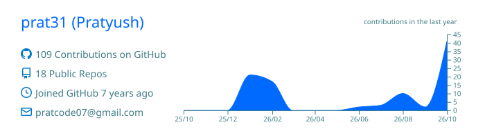

<h2 align="center">Hi, I'm Pratyush 👋</h2>

  

  
  

---

### About

- 🛠️ I build backend services, developer tools and AI-powered automation
- 🏠 I run a homelab and prefer software I can host myself
- 🔭 Currently working on **[kindle-ai-tracker](https://github.com/prat31/kindle-ai-tracker)**, which turns a Kindle into a desk display for AI usage
- 🌱 Exploring local LLMs on Apple Silicon with MLX

### Tech stack

  

### Featured projects

| Project | Description |
| --- | --- |
| [**kindle-ai-tracker**](https://github.com/prat31/kindle-ai-tracker) · Go | Turns a jailbroken Kindle into a desk display for Claude, ChatGPT, Copilot and OpenRouter usage |
| [**idoitmyself**](https://github.com/prat31/idoitmyself) · TypeScript | Self-hosted email automation that labels your inbox from plain-English rules |
| [**sql_query_plan_visualizer**](https://github.com/prat31/sql_query_plan_visualizer) · TypeScript | Turns MySQL query plans into interactive graphs in the browser |
| [**linpuzs**](https://github.com/prat31/linpuzs) · Python | Solves LinkedIn's daily puzzles on an Android phone over ADB |
| [**hey-docu**](https://github.com/prat31/hey-docu) · JavaScript | Containerized RAG app for chatting with your documents |
| [**healthsight**](https://github.com/prat31/healthsight) · Python | Personal dashboard for Health Connect exports |

### GitHub activity

  
  

  

  

<picture>
  <source media="(prefers-color-scheme: dark)" srcset="https://raw.githubusercontent.com/prat31/prat31/output/github-snake-dark.svg" />
  
</picture>
